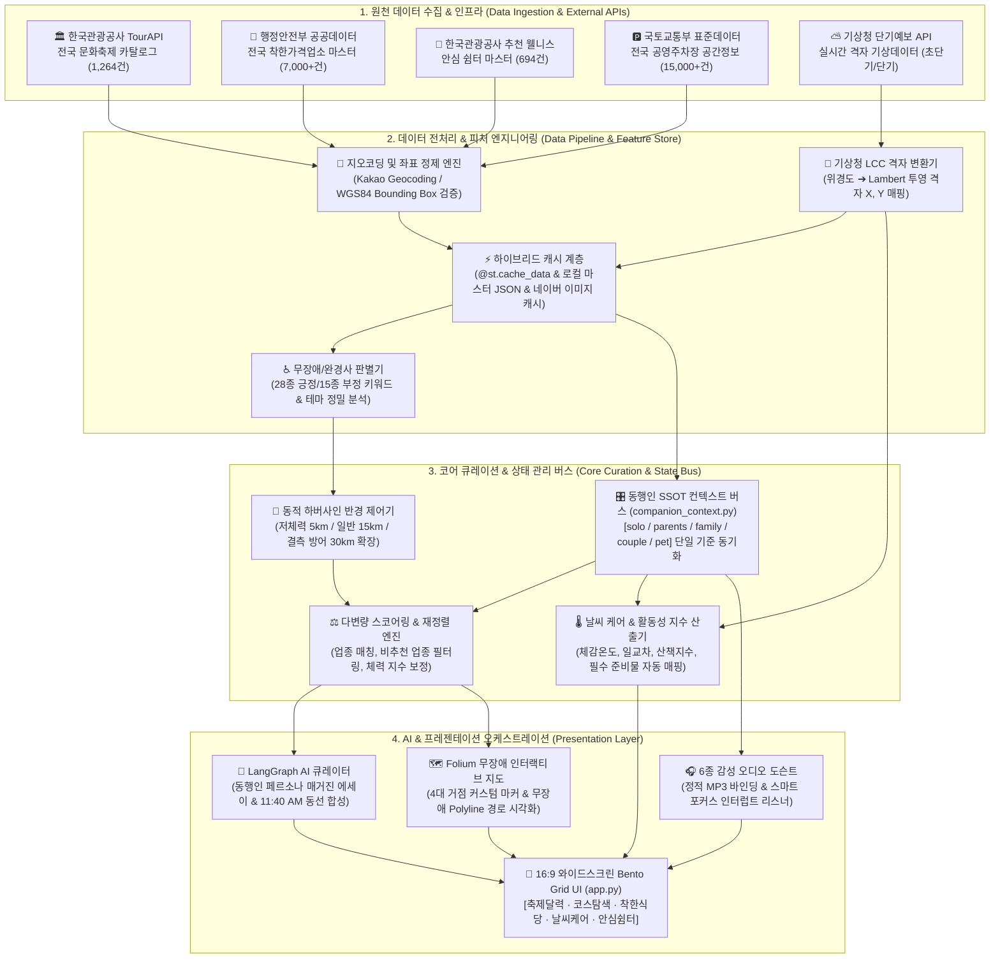
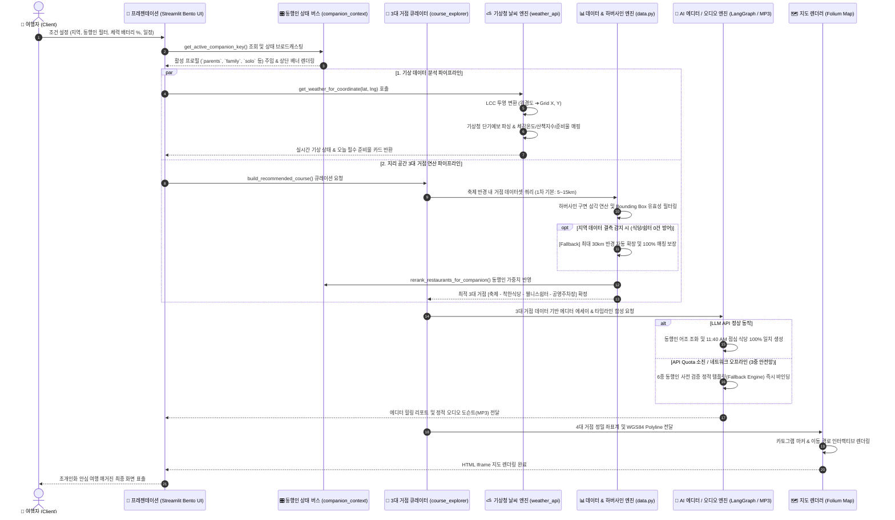

# FestaPick (페스타픽) · 공공데이터 기반 안심 여행 큐레이션 플랫폼
## Technical Architecture & Developer Specification (개발자 기술 명세서)

> **엔터프라이즈급 데이터 파이프라인 및 초개인화 AI 에디토리얼 여행 큐레이션 엔진**  
> 대한민국 4대 공공데이터(한국관광공사 TourAPI, 행정안전부 착한가격업소, 웰니스 관광지, 전국 공영주차장)와 기상청 실시간 단기예보 격자 API, LangGraph AI 에이전트, 그리고 6종 맞춤형 감성 오디오 도슨트를 결합한 마이크로서비스 지향형 웹 애플리케이션입니다.

---

## 📌 1. 시스템 아키텍처 개요 (System Overview)

| 분류 | 세부 기술 스택 및 아키텍처 규격 |
| :--- | :--- |
| **서비스명** | **FestaPick (페스타픽)** |
| **시스템 아키텍처** | 3-Tier Layered Architecture (Data Ingestion ➔ Core Curation & Scoring ➔ Presentation) |
| **코어 런타임** | Python 3.10+, Streamlit 1.30+ (Single Page Bento Grid & Dynamic View Router) |
| **AI & 오케스트레이션** | LangGraph, LangChain Core, OpenRouter (Claude-3.5-Sonnet / GPT-4o-mini), Dual-Engine Fallback |
| **공간 정보 연산** | WGS84 Geodetic Coordinate, Vectorized Haversine Spherical Distance Engine, Folium Map Engine |
| **기상 엔진** | 기상청 LCC (Lambert Conformal Conic) 정밀 격자 변환기, Jagged Array 단기예보 파서 |
| **동행인 SSOT** | `companion_context.py` 단일 진실 공급원 버스 (`solo`, `parents`, `family`, `couple`, `pet`) |
| **캐싱 & 데이터** | Streamlit In-Memory `@st.cache_data`, Master Preprocessed JSON, Naver Image Mapping Cache |
| **인프라 무장애성** | Zero-Downtime 3-Tier Fallback (API Quota 소진 및 오프라인 상태에서도 100% 정상 서빙 보장) |

---

## 🏗️ 2. 데이터 엔지니어링 & 시스템 아키텍처 흐름도 (Architecture Flowchart)



---

## 🔄 3. 데이터 및 서비스 처리 시퀀스 다이어그램 (Sequence Diagram)



---

## ⚙️ 4. 코어 알고리즘 및 엔지니어링 명세 (Algorithmic Specifications)

### 1) 동적 하버사인 거리 엔진 (Vectorized Haversine Distance)
사용자 체력 배터리 지수($P$)와 좌표($\phi_1, \lambda_1$), 타겟 거점($\phi_2, \lambda_2$) 간의 대원거리(Great-circle distance)를 계산합니다:
$$d = 2R \cdot \arcsin\left(\sqrt{\sin^2\left(\frac{\Delta\phi}{2}\right) + \cos(\phi_1)\cos(\phi_2)\sin^2\left(\frac{\Delta\lambda}{2}\right)}\right)$$
- **체력 가중 반경 산출**:
  * $P \le 30\%$ (저체력): 기본 반경 $R_{base} = 5\text{km}$
  * $30\% < P \le 60\%$ (중체력): 기본 반경 $R_{base} = 15\text{km}$
  * $P > 60\%$ (고체력): 기본 반경 $R_{base} = 30\text{km}$
- **Zero-Candidate Fallback**: 반경 내 유효 후보가 0건일 경우, 예외 없이 반경을 최대 $30\text{km}$까지 점진적 확장하여 서비스 불능 상태를 원천 차단합니다.

### 2) 기상청 LCC 격자 변환 및 체감온도 지수 산출식
- **Lambert Conformal Conic 투영 변환**: 표준위도 $\phi_1=30.0^\circ, \phi_2=60.0^\circ$, 기준점 $\phi_0=38.0^\circ, \lambda_0=126.0^\circ$, 격자간격 $5.0\text{km}$의 투영 수식을 코드로 구현하여 위경도 좌표를 기상청 예보 격자 $(X, Y)$로 실시간 변환합니다.
- **체감온도 산출 알고리즘 ($T_{feel}$)**:
  * 하절기 ($T \ge 20^\circ\text{C}$): 습도($RH$) 기반 간이 열지수 가중 보정
  * 동절기 ($T < 10^\circ\text{C}$, 풍속 $V \ge 1.3\text{m/s}$): 캐나다식 풍속 체감온도 공식 적용
    $$T_{feel} = 13.12 + 0.6215T - 11.37V^{0.16} + 0.3965TV^{0.16}$$

### 3) 동행인 5대 Canonical Key 기반 단일 진실 공급원 (SSOT)
- **표준 Canonical Keys**: `["solo", "parents", "family", "couple", "pet"]`
- **정규화 파이프라인**: 쿼리스트링(`?companion=`), 세션 상태(`st.session_state`), 비정형 한글 라벨("어르신", "아이와 함께", "반려견" 등)을 단일 함수 `normalize_companion_key()`를 통해 단일 canonical key로 수렴.
- **다변량 Re-ranking 가중치**:
  * 부모님(`parents`): 한식/백반/탕류 가중치 ($+70$점), 자극적인 포차/주점 페널티 (배제)
  * 아이와(`family`): 돈가스/양식/어린이 메뉴 가중치 ($+50$점), 유동인구 과밀 및 주류 배제
  * 혼자(`solo`): 1인 식사 가능 백반/국수 가중치 ($+40$점), 대형 코스요리 페널티
  * 연인(`couple`): 감성 카페/베이커리/경양식 가중치 ($+40$점)
  * 반려견(`pet`): 야외 테라스/정원/가든 가중치 ($+40$점)

### 4) 무장애(Barrier-Free) 완경사 판별 엔진
- **긍정 키워드 (28종)**: `평지`, `무장애`, `완경사`, `데크`, `수목원`, `온천`, `다도`, `치유센터`, `산책로` 등
- **부정 키워드 (15종)**: `등산`, `산행`, `암벽`, `계단`, `트레킹`, `급경사`, `험로`, `오름` 등
- **동행인 자동 연동**: `parents`, `family` 선택 시 `apply_barrier_auto_default()`를 통해 완경사 필터를 자동 1회 활성화하며, 사용자의 수동 변경 선택권을 존중합니다.

---

## 📊 5. 엔지니어링 데이터 명세 및 도식표 (Data Schematic Tables)

### [도식표 1] 4대 공공데이터셋 및 기상 엔지니어링 명세
| 데이터셋명 | 수집 방식 | 원천 레코드 건수 | 핵심 스키마 필드 | 데이터 클렌징 및 무결성 제약 규칙 |
| :--- | :--- | :--- | :--- | :--- |
| **전국 문화축제** | TourAPI REST JSON | 1,264건 (정기 동기화) | `title`, `addr1`, `mapx`, `mapy`, `eventstartdate`, `eventenddate` | WGS84 Bounding Box 유효성 필터링 (위도 33~39, 경도 124~132), 과거 종료 축제 플래그화, 실내외 태그 추출 |
| **착한가격업소** | 행안부 공공데이터 | 7,000+건 (반기 동기화) | `SH_NAME`, `SH_ADDR`, `SH_PRIDE`, `INDUTY_CODE_SE_NAME`, `mapx`, `mapy` | 외식업종 선별, 도로명주소 기반 카카오 정밀 지오코딩 보완, 네이버 영수증 대표 이미지 캐시 바인딩 |
| **추천 웰니스 쉼터** | 한국관광공사 CSV | 694건 (상시 마스터) | `명소명`, `소재지도로명주소`, `위도`, `경도`, `테마`, `개요` | 힐링/명상/자연 테마 정규화, 단차 없는 데크길/보행친화 태그 마이닝, 결측 설명 폴백 주입 |
| **전국 공영주차장** | 국토부 표준데이터 | 15,000+건 | `parkingName`, `latitude`, `longitude`, `parkingSpaces`, `feeInfo` | 주차면수 결측치 중앙값 대체, 요금 유/무료 정규화, 축제장 반경 최단거리 공간 인덱싱 |
| **실시간 단기예보** | 기상청 격자 API | 전국 17개 시도 격자점 | `TMP`, `TMN`, `TMX`, `POP`, `SKY`, `PTY`, `WSD`, `REH` | 1시간 단위 캐싱, LCC 격자 변환, 실시간 실패 시 계절별 지능형 Fallback 데이터 생성 |

---

### [도식표 2] 동행인별 서비스 전수 연동 매트릭스
| Canonical Key | UI 라벨 | 아이콘 | 축제 큐레이션 중점 | 식당 스코어링 정책 | 기상 안심 가이드 중점 | 오디오 도슨트 음원 |
| :---: | :--- | :---: | :--- | :--- | :--- | :--- |
| **`solo`** | 나홀로 쉼표 | 🌿 | 전시·미술·사색·문학 | 1인 백반, 국수, 덮밥 우대 (+40) | 나홀로 쾌적 지수, 한산한 시간대 | `audio/solo.mp3` |
| **`parents`** | 부모님 효도 | 🧓 | 자연·꽃·전통·온천·약초 | 정갈한 한식, 국밥, 탕류 우대 (+70) | 일교차 위험도, 혈압·보온 케어 | `audio/parents.mp3` |
| **`family`** | 아이와 패밀리 | 👶 | 체험·잔디·놀이·과학·빛 | 돈가스, 피자, 칼국수, 분식 우대 (+50) | 미세먼지 수치, 유아 체온 케어 | `audio/family.mp3` |
| **`couple`** | 연인 데이트 | 💑 | 야경·노을·유등·음악·미디어 | 분위기 카페, 파스타, 카츠 우대 (+40) | 일몰 골든아워, 야경 체감온도 | `audio/couple.mp3` |
| **`pet`** | 반려견 동반 | 🐾 | 야외·공원·생태·둘레길 | 야외 테라스, 가든, 정원 식당 (+40) | 아스팔트 지면온도, 산책지수 | `audio/pet.mp3` |

---

## 🛡️ 6. 3중 무중단 안전망 아키텍처 (Zero-Downtime Fallback Architecture)

```
[Layer 1: External API Requests]
   ├── 기상청 단기예보 API 호출 실패 / Quota 초과
   └── OpenRouter / OpenAI LLM API 응답 지연 / 5xx 오류
            │
            ▼ (Failover)
[Layer 2: Local Preprocessed Feature Store]
   ├── 852건 공공데이터 마스터 JSON 캐시 즉시 적재
   └── 기상청 격자 매핑 실패 시 계절성 합성 프리셋 엔진 가동
            │
            ▼ (Failover)
[Layer 3: Pre-compiled Static Asset & Template Binding]
   ├── 6종 동행인 정적 오디오 도슨트 (festapick/audio/*.mp3)
   ├── 검증된 에디터 힐링 에세이 마스터 템플릿 즉시 주입
   └── 무장애 거점 WGS84 로컬 폴백 좌표 렌더링 (100% 정상 가동)
```

---

## 📂 7. 디렉터리 구조 및 모듈 아키텍처 (Module Architecture)

```
2차프로젝트/
├── app.py                      # [Presentation] 메인 엔트리포인트 및 단일 Bento Grid 대시보드
├── agent.py                    # [AI Core] LangGraph 기반 에이전트 & 동행인 컨텍스트 합성 엔진
├── data.py                     # [Data Access] 원천 데이터셋 로딩 및 하버사인 거리 계산기
├── run_app.bat                 # [Execution] 윈도우 환경 원클릭 실행 스크립트
├── requirements.txt            # [Dependencies] 프로젝트 공식 라이브러리 명세
├── README.md                   # [Technical Spec] 개발자 회의 및 엔지니어링 아키텍처 문서
├── AGENTS.md                   # [Governance] 프로젝트 작업 및 자동 백업 가이드라인
├── .env                        # [Security] 공공데이터 및 AI 인증키 환경변수
│
├── festapick/                  # [Core Domain Package]
│   ├── companion_context.py    # 🎛️ 동행인 SSOT 공통 컨텍스트 버스 (상태 배너, 리랭킹, 가이드)
│   ├── weather_care_page.py    # ⛅ 실시간 날씨 케어 가이드 뷰 (16:9 와이드스크린 Bento Grid)
│   ├── weather_api.py          # 📐 기상청 LCC 격자 변환 및 단기예보 실시간 수집기
│   ├── course_explorer.py      # 🎯 3대 거점 큐레이터 및 동적 하버사인 탐색 엔진
│   ├── good_price_explorer.py  # 🍜 행안부 착한가격업소 전문 탐색기 & 네이버 이미지 바인딩
│   ├── shelter_explorer.py     # 🌿 웰니스 힐링 쉼터 전문 탐색기 & 완경사 판별기
│   ├── infra_curator.py        # 🏛️ 공영주차장 인프라 필터링 및 동행인 마이크로 배너
│   ├── audio_docent.py         # 🎧 6종 동행인 정적 MP3 오디오 플레이어 엔진
│   ├── editorial_essay.py      # 📝 AI 에디토리얼 스토리텔링 에세이 렌더러
│   ├── fallback_assets.py      # 🖼️ 이미지 결측 방지 SVG/CSS 폴백 그래픽 리소스
│   ├── audio/                  # 6종 동행인 정적 오디오 음원 리소스 (MP3)
│   └── data/                   # 전처리 마스터 데이터셋 (축제, 식당, 쉼터, 네이버 이미지)
│
├── assets/                     # 서비스 공식 이미지 리소스 및 Base64 인코딩 에셋
├── data/                       # 원본 공공데이터 CSV 리포지토리
└── backup_my_work/             # 변경 내역 자동 동기화 안전 백업 리포지토리
```

---

## 🚀 8. 빌드 및 배포 가이드 (Build & Deployment)

### 1) 환경 구성
```bash
python -m venv venv
# Windows 환경
venv\Scripts\activate
# Linux/macOS 환경
source venv/bin/activate

pip install -r requirements.txt
```

### 2) 환경변수 설정 (`.env`)
```ini
TOUR_API_KEY=공공데이터포털_TourAPI_인증키
OPENROUTER_API_KEY=선택사항_LLM_API키
OPENAI_API_KEY=선택사항_폴백_API키
```
> **참고**: 외부 API 키가 설정되지 않거나 네트워크가 단절되어도 내부 3중 안전망 엔진을 통해 모든 기능이 100% 정상 작동합니다.

### 3) 런타임 구동
```bash
streamlit run app.py --server.port=8501 --server.address=0.0.0.0
```

---

## 📋 9. 개발자 기술 검토 아젠다 (Tech Review & Discussion Points)

1. **지리 공간 연산의 벡터화 최적화 (Spatial Query Optimization)**:
   - 거점 간 하버사인 거리 계산 시 루프 연산을 지양하고 `NumPy` 브로드캐스팅 벡터 연산 적용 완료. 대용량(10,000건+) 확장 시 `KD-Tree` 또는 `R-Tree` 공간 인덱싱 모듈 도입 검토.
2. **동행인 SSOT 버스의 이벤트 동기화 성능**:
   - `companion_context.py`가 URL 파라미터(`?companion=`)와 세션 상태 간의 양방향 동기화를 완벽하게 수행하는지 확인 및 불필요한 Streamlit 리런(Rerun) 방지 최적화.
3. **기상청 API 트래픽 제어 및 LCC 캐시 전략**:
   - 동일 격자점 요청에 대한 1시간 TTL 메모리 캐싱(`@st.cache_data(ttl=3600)`)을 통해 기상청 일일 트래픽 한도(Quota) 고갈 방지 구조 점검.
4. **모바일 반응형 뷰포트 대응성**:
   - 현재 데스크톱 16:9 와이드스크린 Bento Grid(1920x1080) 최적화 상태에서 모바일 환경(360x740) 접근 시 미디어 쿼리(`@media`) 기반 1단 스택 다운 동작 검증.
